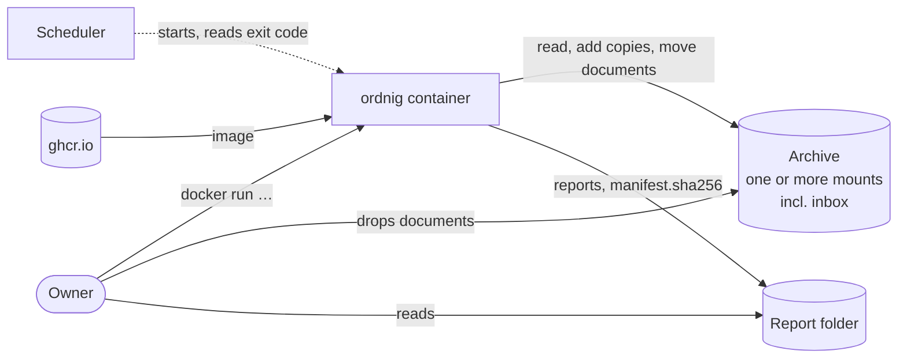

# 3 Context and scope

| Neighbour | Interface |
| --- | --- |
| Archive | Mounted at `/ablage` (one mount, or several below it); read-only for `preview`, `check`, `verify`; writable for `run` and `sort --apply`. |
| Inbox | Folder in the archive (default `00_Eingang`); documents of any format. |
| Report folder | Mounted at `/report`, outside the archive: Markdown reports, CSVs, checksum baseline. |
| Scheduler (optional) | systemd timer, cron, NAS task scheduler; acts on the exit code ([8](08-concepts.md#exit-codes)). Notifying the owner is its job. |

**Out of scope:** backup and restore (`verify` detects damage, a versioned backup
repairs it), editing documents, renaming files, fetching documents from elsewhere.

> [!IMPORTANT]
> **Q11 – HEIC and Outlook .msg:** `sort` cannot read HEIC photos or Outlook `.msg` files; they go to the review folder.
> Both are common for scanned or forwarded mail (phone photos, Outlook). Support them next?

> [!IMPORTANT]
> **Q12 – Fetching documents:** Fetching documents from provider portals (banks, insurers) would feed the inbox. As
> part of ordnig it needs logins and per-portal code, which ordnig avoids so far. Keep
> it out of scope (a separate tool that writes into the inbox), or plan it in?
