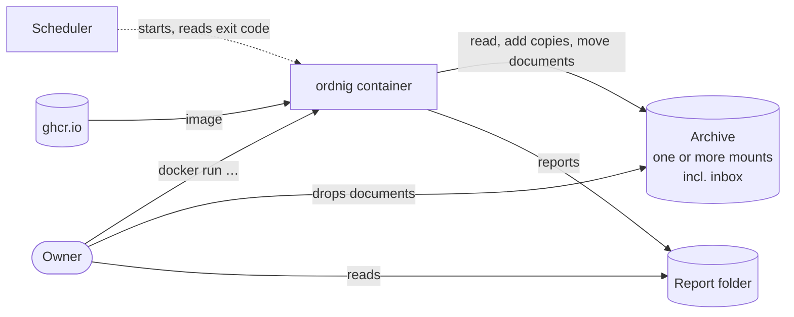

# 3 Context and scope

| Neighbour | Interface |
| --- | --- |
| Archive | Mounted at `/ablage` (one mount, or several below it); read-only for `preview`, `check`, `verify`; writable for `run` and `sort --apply`. |
| Inbox | Folder in the archive (default `00_Eingang`); documents of any format. |
| Report folder | Mounted at `/report`, outside the archive: Markdown reports and CSVs per run. |
| Scheduler (optional) | systemd timer, cron, NAS task scheduler; acts on the exit code ([8](08-concepts.md#exit-codes)). Notifying the owner is its job. |

**Out of scope:** backup and restore (`verify` detects damage, a versioned backup
repairs it), editing documents, renaming files, fetching documents from elsewhere
(portal logins and credentials stay out of ordnig; any tool or person can drop files
into the inbox).

Not read yet: HEIC photos ([#13](https://github.com/Tiliavir/ordnig/issues/13)) and
Outlook `.msg` ([#14](https://github.com/Tiliavir/ordnig/issues/14)); both need a new
package and go to the review folder until then.

