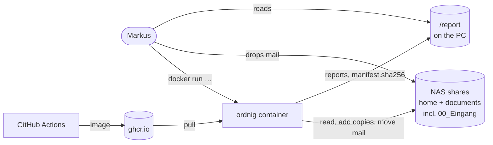

# 3 Context and scope

| Neighbour | Interface |
| --- | --- |
| Archive (NAS) | Mounted at `/ablage`; read-only for `preview`, `check`, `verify`; writable for `run` and `sort --apply`. |
| Inbox `00_Eingang` | Folder in the `home` share; Markus drops mail there in any format. |
| `/report` | Mounted folder outside the archive: Markdown reports, CSVs, checksum baseline. |
| Scheduler (planned) | Starts the container; reads only the exit code ([8](08-concepts.md#exit-codes)). |

**Out of scope:** backup and restore, repairing damaged files, editing
documents, renaming files (they keep their names).

> [!IMPORTANT]
> **Q11 – HEIC and Outlook .msg:** `sort` cannot read HEIC photos or Outlook `.msg` files; they go to `_Prüfen`.
> Does mail arrive in these formats (phone photos of letters, mails saved from Outlook)?
> If yes, support for them would be the next feature.

> [!IMPORTANT]
> **Q12 – Portal downloads:** You want letters fetched automatically from provider portals (banks, insurers, building
> society, energy supplier). Should that become part of ordnig (filling `00_Eingang`) or
> a separate tool? It needs logins and per-portal code, which ordnig avoids so far.

> [!IMPORTANT]
> **Q13 – Backup and repair:** `verify` only detects bit rot; a damaged file must come back from a backup. Which
> backup covers both shares (e.g. Synology Hyper Backup), and does it keep versions
> older than the next `verify`? Otherwise a damaged file would already be in the backup.
