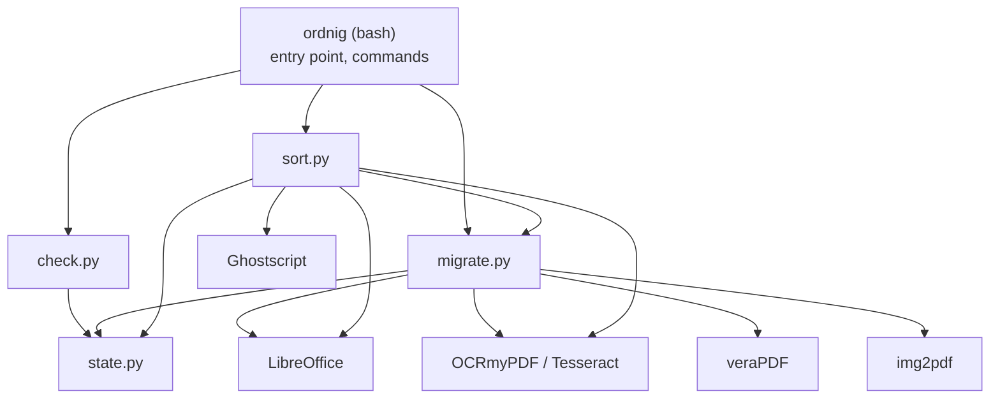

# 5 Building blocks

| Block | Responsibility |
| --- | --- |
| `src/ordnig` | Entry point: `preview` (default), `run`, `check`, `verify`, `sort`, `version`; passes exit codes on. |
| `check.py` | Read-only scan: format risk, structure checks, names, duplicates, checksums; `report.md`, `files.csv`, `duplicates.csv`, `manifest.sha256`; with `--verify` the bit-rot comparison. |
| `migrate.py` | Plans and runs conversions (preview unless `--apply`), validates with veraPDF, writes the conversion log. |
| `sort.py` | Learns from the archive, reads and classifies inbox files, moves them, writes copies and the history. |
| `state.py` | Finds the `.ordnig` folder, holds the lock, checks the format version, maps exit codes. |
