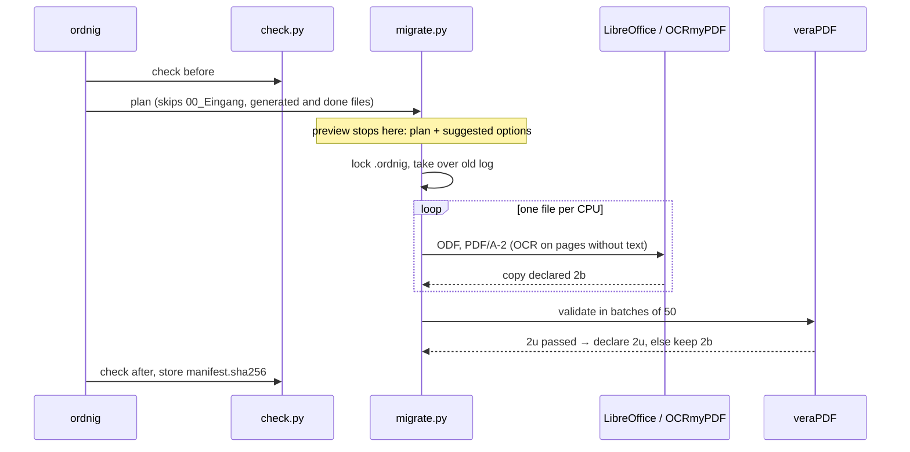
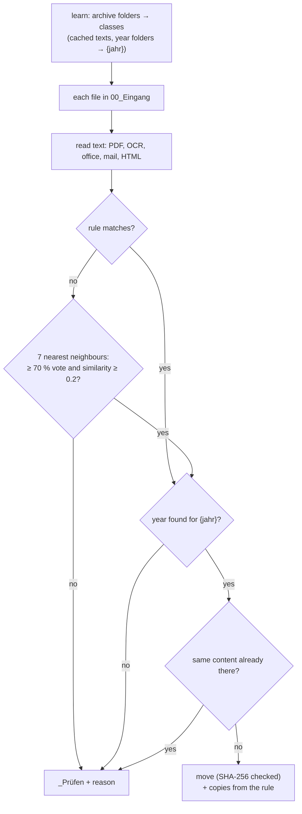
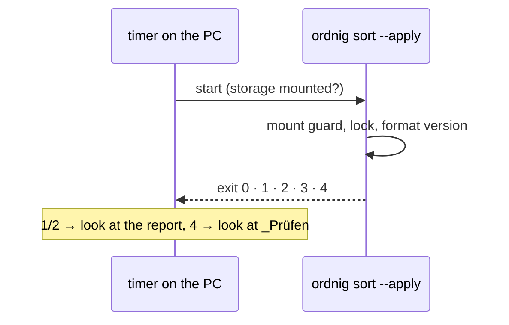

# 6 Runtime view

## Check and convert (`preview`, `run`)

1. Office file → ODF next to it.
2. Office/ODF → PDF/A-2 (tagged, fonts embedded); OCRmyPDF `--skip-text` only
   for pages without text.
3. PDF → `<name>_pdfa.pdf` via OCRmyPDF `--skip-text`; image (only with
   `--images`) → img2pdf → OCRmyPDF. PDF/A with text on every page is skipped.
   `--fix-scans` adds rotation and deskew (≈ 40 % more OCR time).
4. Copies get the original's modification time. Targets are reserved while
   planning, so parallel jobs never collide (`x.doc` + `x.rtf` → `x.odt`, `x.rtf.odt`).
5. Parallel: one file per CPU, one OCR thread per file. Seconds per file are
   logged; the report lists the slowest files.
6. Interrupted? The next `run` continues: generated files are not converted
   again, finished sources are skipped, failed ones retried.

## Sort the inbox (`sort`)

- Preview by default; `--apply` moves. `--eval` sorts a sample of the archive
  as if it were new and shows coverage, accuracy and year accuracy per threshold.
- Move across file systems: copy, fsync, compare SHA-256, then delete. Never
  overwrite; a name collision gets `_2`.
- Copies (`kopie`, e.g. into a tax year folder) only after the original is filed, with the same
  check; a failed copy is an error, the filed original stays.
- Every `--apply` appends to `.ordnig/protokoll.csv`.

## Bit rot (`verify`)

`check --verify` hashes everything again and compares with `/report/manifest.sha256`:
changed content and missing files are findings (exit 1); files found under a new
path with the same hash count as moved, new files as new.

Like `run`, `check` and `verify` skip the inbox: unsorted documents are not part of the
archive yet, and documents filed by `sort` count as new, not as moved. Inbox entries in an
older manifest are ignored.

## Unattended run

