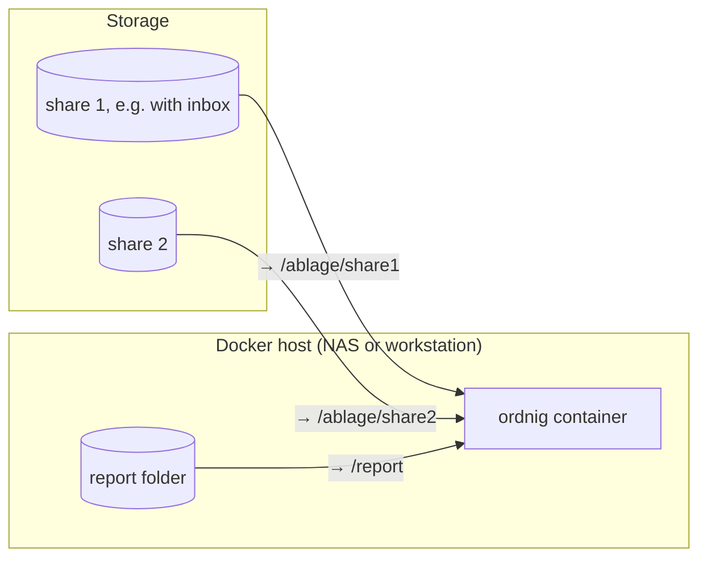

# 7 Deployment



| Variant | When | Note |
| --- | --- | --- |
| On the NAS | Enough CPU and RAM; simplest | Task scheduler of the NAS starts it. |
| On a workstation, storage mounted | Faster CPU for OCR and conversions | Shares mounted on the host; runs only while it is on. |
| One archive mount | Archive in one share | `-v <archive>:/ablage` |
| Several mounts | Archive spread over shares | `-v <share>:/ablage/<name>` each, always with the same names; the inbox is found as `/ablage/*/00_Eingang`. |

```sh
docker run --rm --user "$(id -u):$(id -g)" \
  -v /mnt/nas/share1:/ablage/share1 -v /mnt/nas/share2:/ablage/share2 \
  -v "$PWD/report:/report" ghcr.io/tiliavir/ordnig:<version> sort --apply
```

Requirements:

- **Locks across machines:** the storage must support POSIX locks (local disk,
  NFS with lockd, SMB/cifs without `nobrl`); otherwise two hosts may run at once.
  ordnig warns when its state folder lies on a cifs mount with `nobrl`.
- **Checksum baseline:** `/report/manifest.sha256` must be kept outside the archive
  and backed up; without it `verify` has nothing to compare with.
- **Same mount names every run:** the mount point may change, the names below it may not ([ADR](adr/ADR-20261117-state-folder.md)).
- **Unmounted storage:** Docker creates an empty folder for a missing host path;
  the mount guard stops `sort` then ([8](08-concepts.md#mount-guard)).
- Pin the image version; after an update run `sort --eval` before `--apply`.

OCR (Tesseract) uses the CPU only; a GPU does not speed it up.
