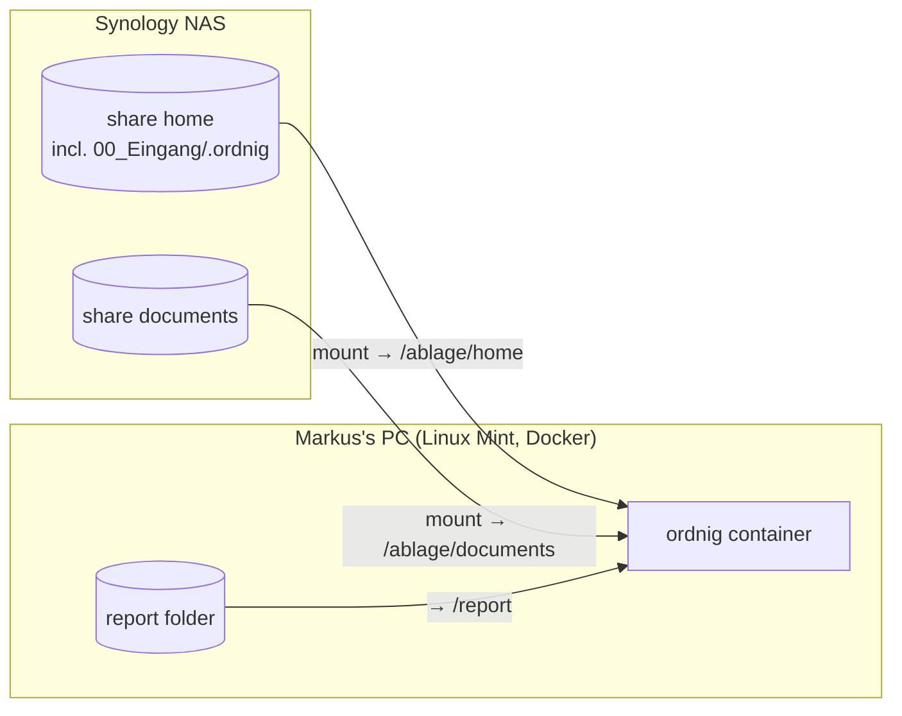

# 7 Deployment



```sh
docker run --rm --user "$(id -u):$(id -g)" \
  -v /mnt/nas/home:/ablage/home -v /mnt/nas/documents:/ablage/documents \
  -v "$PWD/report:/report" ghcr.io/tiliavir/ordnig:0.8.0 sort --apply
```

- The inbox is found as `/ablage/*/00_Eingang`; with exactly one share holding
  an inbox, `--eingang` is not needed.
- If a share is not mounted on the PC, Docker creates an empty folder; the
  mount guard stops `sort` then ([8](08-concepts.md#mount-guard)).
- Pin the image version; after an update run `sort --eval` before `--apply`.

<a id="q3"></a>
> [!IMPORTANT]
> **Q3 – NFS or SMB:** The lock works across machines only with POSIX locks: NFS with lockd, or SMB
> (cifs) without `nobrl`. How are the shares mounted on the PC? Not tested on the real mount yet.

<a id="q4"></a>
> [!IMPORTANT]
> **Q4 – /report and manifest.sha256:** `manifest.sha256` is the baseline for bit rot and must not live in the archive. On
> the PC it is in the report folder you mount. Which folder, and is it backed up? If it
> is lost, `verify` has nothing to compare with.

<a id="q5"></a>
> [!IMPORTANT]
> **Q5 – Start and notification:** Manually, or a systemd timer on the PC (only while it is on)? And how should exit 1,
> 2 and 4 reach you: desktop notification, mail, nothing (you read the report)?

<a id="q6"></a>
> [!IMPORTANT]
> **Q6 – GPU as the reason for the PC:** The PC was chosen for its GPU, but Tesseract (via OCRmyPDF) runs on the CPU only.
> The PC is still the better host if it has more CPU than the NAS. Does the decision
> stay as it is, or should `verify` (no OCR) run on the NAS as a monthly task?
